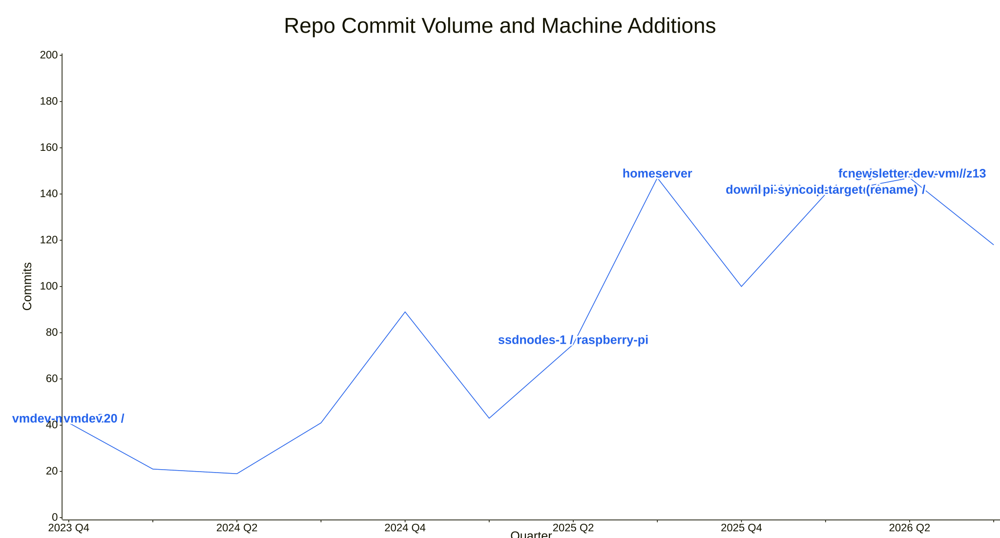

## Acknowledgments

A special thanks to [`@sarcasticadmin`](https://github.com/sarcasticadmin) for
pointing me down the Nix road. Rob's [flake
example](https://github.com/sarcasticadmin/systems) of Nix possibilities became
the foundation for managing all of my machines declaratively.

**This is the way.**

# systems

A single NixOS flake defining 11 machines:
- 7 physical boxes: laptops, servers, a VPS, and a Raspberry Pi
- 4 Incus VMs on `xps17` (managed by OpenTofu).



## Fleet Architecture

- **Shared modules.** Per-machine config lives in `nix/machines/<name>/`;
  reusable modules (base packages, sway desktop, dev tooling, VPN clients,
  build-machine, …) live in `nix/machines/_common/` and are composed per
  machine.
- **Secrets.** Encrypted secrets live in a dedicated private repository
  imported as the `systems-secrets` flake input; `sops-nix` decrypts them on
  each machine.
- **Networking.** The headscale-managed **tailnet** (`*.tailnet.rueb.dev`,
  `100.64.0.0/20`) is the primary overlay and the standard way to reach every
  machine. `wgnet` is a legacy WireGuard network retained for one purpose only:
  [Jellyfin](https://github.com/jellyfin/jellyfin) on `homeserver` serves its
  wgnet clients on `10.100.0.2`. The WireGuard server is a network appliance,
  not a NixOS service, and no other machine joins wgnet.
- **VMs.** [Incus](https://linuxcontainers.org/incus/) on `xps17` runs the guest
  VMs; instances and their CPU, memory, and networking are declared with
  OpenTofu in [`tofu/`](tofu/). Guests are NixOS systems updated in place via
  `nup-fleet`. See [Incus VM management](docs/incus-vm-management.md).
- **Cross-building.** `fwai0` and `xps17` import `build-machine.nix`, which
  enables aarch64 binfmt emulation and tuning for slow ARM builds — used to
  build the `pi-syncoid-target` SD image
  (`scripts/build-raspberrypi-image.sh`).

## nup-fleet

[`nup-fleet`](dotfiles/bin/nup-fleet) builds on the builder and applies
configurations to the fleet over SSH.

### Usage

```bash
nup-fleet                # rebuild + switch every machine in the list
nup-fleet driver         # one machine, by flake config name
nup-fleet build          # build all configs locally only (no deploy)
nup-fleet --upgrade       # run `nix flake update` first, then deploy all
nup-fleet --upgrade xps17  # flake update + single machine
```

`nup-fleet all` deploys the whole list even if a machine fails, then exits
non-zero with the failed hosts; `nup-fleet <machine>` is fail-fast. Set
`EXCLUDE="host1,host2"` to skip hosts (used by CI, which must not rebuild
the runner it is executing on).

All compilation is offloaded to `fwai0` via `nixos-rebuild --build-host`;
the invoking host only evaluates the flake. There is no silent fallback: if
`fwai0` is unreachable the rebuild fails rather than compiling locally. Set
`ALLOW_LOCAL_BUILD=true` only to deliberately build on an underpowered host.

### Automated upgrades

A Forgejo Actions workflow runs [`nup-fleet --upgrade`](dotfiles/bin/nup-fleet)
nightly at 03:30 America/Chicago (see
[`.forgejo/workflows/nup-fleet-upgrade.yaml`](.forgejo/workflows/nup-fleet-upgrade.yaml)).
It targets the `nixos` host-mode runner label on `forgejo-ci-runner-vm`, so
the job executes on that VM's host rather than inside an ephemeral job
container.

The workflow has two jobs:

1. **`check-sops-secrets`** evaluates every `nixosConfigurations` entry and
   fails if a host declares a `sops.secrets.<name>` that has no matching key
   in the `systems-secrets` repo -- the error that would otherwise only
   appear as a `manifest.json` build failure during the deploy. It reads the
   `systems-secrets` revision the flake already locks to (anonymously
   readable), so it needs no extra checkout or credentials, and no age key
   (secret names are cleartext in the sops file).
2. **`upgrade`** runs `nup-fleet --upgrade`, then commits and pushes the
   updated `flake.lock` back to the branch. It excludes
   `forgejo-ci-runner-vm` (override with the repo variable
   `NUP_FLEET_EXCLUDE`) so activating the new config cannot restart the
   runner and kill the job; that VM is updated manually.

Host-mode jobs run as the dedicated **`nixdeploy`** user, defined once in
[`nix/machines/_common/nix-deploy-user.nix`](nix/machines/_common/nix-deploy-user.nix)
and imported by every machine:

- `nixdeploy` is a nix `trusted-user`, so `nix copy` can push unsigned
  closures when `nixos-rebuild --target-host` deploys.
- It has `NOPASSWD` sudo for activation and is key-only (no password, no
  interactive shell).
- The private half of its deploy key is the sops secret
  `forgejo_runner_ssh_key`, decrypted only on `forgejo-ci-runner-vm`; the
  public half is committed in the module above.

Rotating the deploy key means regenerating the pair, updating the literal
in `nix-deploy-user.nix`, and adding the private key to the
`systems-secrets` `forgejo-ci-runner-vm.yaml` file.

### Secrets preflight

`scripts/check-sops-secrets.sh` compares the `sops.secrets.<name>` a host
declares in Nix against the keys present in that host's `systems-secrets`
file. `nup-fleet` deploys succeed only when every declared secret exists;
the check surfaces that before a deploy can fail on a far-away machine.

Run it locally with:

```bash
scripts/check-sops-secrets.sh            # every nixosConfigurations host
scripts/check-sops-secrets.sh driver     # a subset
```

It resolves `systems-secrets` from the revision the flake locks to, so no
extra checkout is needed; decrypting is attempted when an age key is
available and otherwise the encrypted file's cleartext key names are used.

### Machines

| Machine | Role | config/services |
|---------|------|-----------------|
| `dev-vm-xps` | Dev VM | Docker, [k3d](https://github.com/k3d-io/k3d), Go, Python, Rust, [Hugo](https://github.com/gohugoio/hugo) |
| `driver` | daily driver thin client | [Sway](https://github.com/swaywm/sway), gaming (ROCm), sing-box client, tailnet |
| `forgejo-ci-runner-vm` | Forgejo runner | [Forgejo Runner](https://code.forgejo.org/forgejo/runner), docker + `nixos` host-mode labels, `nixdeploy` fleet deploy identity |
| `fwai0` | Fleet builder and LLM inference server | [`halogen-flash-server`](https://github.com/peonist-ai/halogen-flash-server) (ROCm, AMD Strix Halo) serving [`Qwen3.8-Flash-Next`](https://huggingface.co/peonist-ai/halogen-qwen3.8-flash-next) over the tailnet (llama.cpp module retained but disabled) |
| `homeserver` | App, file, and mail server | [Stalwart](https://github.com/stalwartlabs/stalwart), [Gmail sync](https://github.com/imapsync/imapsync), [Jellyfin](https://github.com/jellyfin/jellyfin), [Immich](https://github.com/immich-app/immich), [Audiobookshelf](https://github.com/advplyr/audiobookshelf), [FreshRSS](https://github.com/FreshRSS/FreshRSS), [SearXNG](https://github.com/searxng/searxng), [Open WebUI](https://github.com/open-webui/open-webui) |
| `pi-syncoid-target` | ZFS replication target | Hourly [`syncoid`](https://github.com/jimsalterjrs/sanoid) snapshot replication of `homeserver`'s `tank/data` dataset |
| `ssdnodes-1` | Public MX relay and web host | [Postfix](https://github.com/vdukhovni/postfix) relay to [Stalwart](https://github.com/stalwartlabs/stalwart) over the tailnet, nginx reverse proxy, containerized [WordPress](https://hub.docker.com/_/wordpress/) sites |
| `xps17` | Incus VM host | [Incus](https://linuxcontainers.org/incus/) VMs declared in [`tofu/`](tofu/), Incus `dir` pool on `devpool`, Docker, [k3d](https://github.com/k3d-io/k3d), ARM64 builds |

## Docs

- [NixOS ZFS install](docs/nixos-zfs-install.md)
- [Incus VM management](docs/incus-vm-management.md)
- [Fleet keys: inventory, rotation, revocation](docs/fleet-keys.md)
- [Host addressing](docs/host-addressing.md)
- [Tailnet exit node](docs/tailnet-exit-node.md)
- [System flake activity chart](docs/system-flake-activity.md)
