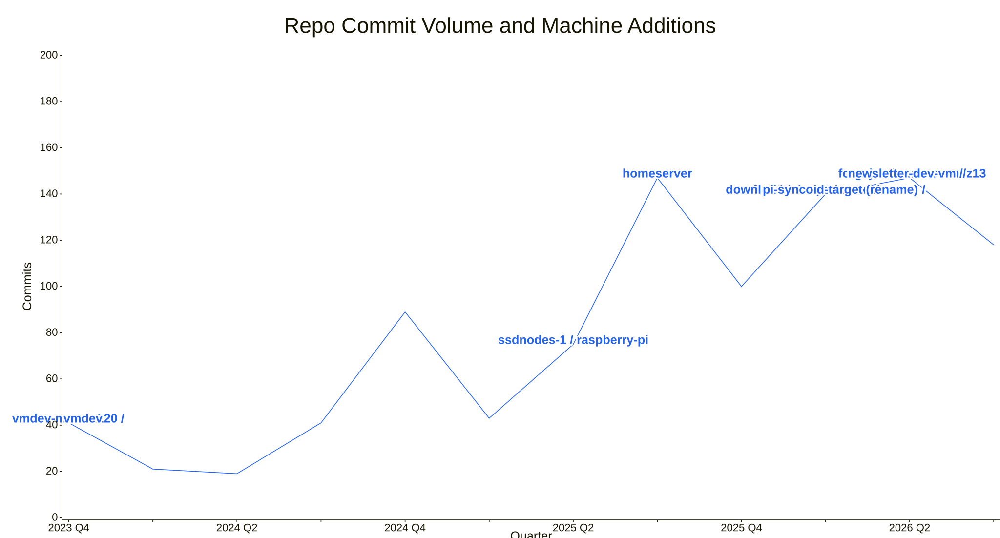

## Acknowledgments

A special thanks to [`@sarcasticadmin`](https://github.com/sarcasticadmin) for
pointing me down the Nix road. Rob's [flake
example](https://github.com/sarcasticadmin/systems) of Nix possibilities became
the foundation for managing all of my machines declaratively.

**This is the way.**

# systems

A single NixOS flake defining 11 machines:
- 7 physical boxes: laptops, servers, a VPS, and a Raspberry Pi
- 4 Incus VMs on `xps17` (managed by OpenTofu).



## Fleet Architecture

- **Shared modules.** Per-machine config lives in `nix/machines/<name>/`;
  reusable modules (base packages, sway desktop, dev tooling, VPN clients,
  build-machine, …) live in `nix/machines/_common/` and are composed per
  machine.
- **Secrets.** Encrypted secrets live in a dedicated private repository
  imported as the `systems-secrets` flake input; `sops-nix` decrypts them on
  each machine.
- **Networking.** The headscale-managed **tailnet** (`*.tailnet.rueb.dev`,
  `100.64.0.0/20`) is the primary overlay and the standard way to reach every
  machine. `wgnet` is a legacy WireGuard network retained for one purpose only:
  [Jellyfin](https://github.com/jellyfin/jellyfin) on `homeserver` serves its
  wgnet clients on `10.100.0.2`. The WireGuard server is a network appliance,
  not a NixOS service, and no other machine joins wgnet.
- **VMs.** [Incus](https://linuxcontainers.org/incus/) on `xps17` runs the guest
  VMs; instances and their CPU, memory, and networking are declared with
  OpenTofu in [`tofu/`](tofu/). Guests are NixOS systems updated in place via
  `nup-fleet`. See [Incus VM management](docs/incus-vm-management.md).
- **Cross-building.** `fwai0` and `xps17` import `build-machine.nix`, which
  enables aarch64 binfmt emulation and tuning for slow ARM builds — used to
  build the `pi-syncoid-target` SD image
  (`scripts/build-raspberrypi-image.sh`).

## nup-fleet

[`nup-fleet`](dotfiles/bin/nup-fleet) builds on the builder and applies
configurations to the fleet over SSH.

### Usage

```bash
nup-fleet                        # rebuild + switch every machine in the fleet
nup-fleet driver                 # one machine, by flake config name
nup-fleet xps17 dev-vm-xps       # several machines, in order
nup-fleet build                  # build all configs locally only (no deploy)
nup-fleet check                  # parse, evaluate and build everything; deploy nothing
nup-fleet check --no-build xps17 # parse and evaluate one config; build nothing
nup-fleet --upgrade              # run `nix flake update` first, then deploy all
nup-fleet --upgrade xps17        # flake update + one machine
nup-fleet --flake-update-only    # just move flake.lock; build and deploy nothing
nup-fleet --list                 # every name the dispatcher accepts
```

The fleet is **read from the flake** at run time -- one `nixosConfigurations`
attribute per machine -- so a host added to the flake is upgraded the next run
without touching this script. `NUP_FLEET_MACHINES="host1 host2"` bypasses the
flake for offline debugging.

Any machine that fails is recorded and the run continues past it, so one broken
host does not leave the rest of the selection un-deployed; the run then exits
non-zero listing what failed. Names are resolved *before* `nix flake update`
runs, so a typo fails immediately instead of after the lockfile has moved.
Set `EXCLUDE="host1,host2"` to skip hosts on a whole-fleet run (used by CI,
which must not rebuild the runner it is executing on); machines named
explicitly on the command line are deployed as asked.

All compilation is offloaded to `fwai0` via `nixos-rebuild --build-host`;
the invoking host only evaluates the flake. There is no silent fallback: if
`fwai0` is unreachable the rebuild fails rather than compiling locally. Set
`ALLOW_LOCAL_BUILD=true` only to deliberately build on an underpowered host.

`nup-fleet check` is the same offloading without the deploy: it parses every
`.nix` file locally, ships the flake source and its locked inputs to `fwai0`, and
does the evaluating and the building there -- `nix flake check --no-build`, then
one `toplevel` realise per host, results left on the builder. Nothing heavy runs
on the invoking host: evaluating the whole fleet in one process peaks at ~3.5G,
which is more than the CI runner has. It stops at the first phase that fails, and
`--no-build` stops after evaluation.

`nup-fleet --upgrade` needs a git credential for the private `systems-secrets`
input; `scripts/setup-forgejo-netrc.sh` installs one. Deploying without
`--upgrade` needs no credential. See
[Secrets](docs/secrets.md#the-private-systems-secrets-input).

### Deploy user

Host-mode jobs run as the dedicated **`nixdeploy`** user, defined once in
[`nix/machines/_common/nix-deploy-user.nix`](nix/machines/_common/nix-deploy-user.nix)
and imported by every machine:

- `nixdeploy` is a nix `trusted-user`, so `nix copy` can push unsigned
  closures when `nixos-rebuild --target-host` deploys.
- It has `NOPASSWD` sudo for activation and is key-only (no password, no
  interactive shell).
- The private half of its deploy key is the sops secret
  `forgejo_runner_ssh_key`, decrypted only on `forgejo-ci-runner-vm`; the
  public half is committed in the module above.

Rotating the deploy key means regenerating the pair, updating the literal
in `nix-deploy-user.nix`, and adding the private key to the
`systems-secrets` `forgejo-ci-runner-vm.yaml` file.

### Machines

| Machine | Role | config/services |
|---------|------|-----------------|
| `dev-vm-xps` | Dev VM | Docker, [k3d](https://github.com/k3d-io/k3d), Go, Python, Rust, [Hugo](https://github.com/gohugoio/hugo) |
| `driver` | daily driver thin client | [Sway](https://github.com/swaywm/sway), gaming (ROCm), sing-box client, tailnet |
| `forgejo-ci-runner-vm` | Forgejo runner | [Forgejo Runner](https://code.forgejo.org/forgejo/runner), docker + `nixos` host-mode labels, `nixdeploy` fleet deploy identity |
| `fwai0` | Fleet builder and LLM inference server | [`halogen-flash-server`](https://github.com/peonist-ai/halogen-flash-server) (ROCm, AMD Strix Halo) serving [`Qwen3.8-Flash-Next`](https://huggingface.co/peonist-ai/halogen-qwen3.8-flash-next) over the tailnet (llama.cpp module retained but disabled) |
| `homeserver` | App, file, and mail server | [Forgejo](https://forgejo.org) (rootless podman), [Stalwart](https://github.com/stalwartlabs/stalwart), [Gmail sync](https://github.com/imapsync/imapsync), [Jellyfin](https://github.com/jellyfin/jellyfin), [Immich](https://github.com/immich-app/immich), [Audiobookshelf](https://github.com/advplyr/audiobookshelf), [FreshRSS](https://github.com/FreshRSS/FreshRSS), [SearXNG](https://github.com/searxng/searxng), [Open WebUI](https://github.com/open-webui/open-webui) |
| `k3s-1`, `k3s-2`, `k3s-3` | k3s cluster (HA control plane) | [k3s](https://k3s-io) embedded etcd, [fleet monitoring](docs/monitoring.md) ([Prometheus](https://prometheus.io), [Grafana](https://grafana.com), [Alertmanager](https://prometheus.io/docs/alerting), [Gatus](https://gatus.io)), NFS-backed PVCs |
| `pi-syncoid-target` | ZFS replication target | Hourly [`syncoid`](https://github.com/jimsalterjrs/sanoid) snapshot replication of `homeserver`'s `tank/data` dataset |
| `ssdnodes-1` | Public MX relay and web host | [Postfix](https://github.com/vdukhovni/postfix) relay to [Stalwart](https://github.com/stalwartlabs/stalwart) over the tailnet, nginx reverse proxy, rootless Podman [WordPress](https://hub.docker.com/_/wordpress) sites |
| `xps17` | Incus VM host | [Incus](https://linuxcontainers.org/incus/) VMs declared in [`tofu/`](tofu/), Incus `dir` pool on `devpool`, Docker, [k3d](https://github.com/k3d-io/k3d), ARM64 builds |

## CI

A PR gate and a nightly/merge deploy, both on `forgejo-ci-runner-vm`:

- **`flake check (PR)`** validates every PR (parses, evaluates and builds on
  `fwai0`; checks secrets and doc links) and deploys nothing.
- **`nup-fleet upgrade`** re-locks, checks secrets, deploys best-effort to the
  fleet, and persists the new `flake.lock`.

Full behavior, the required status check, and the protected-branch push are in
[CI](docs/ci.md). Secrets and the private input are in [Secrets](docs/secrets.md);
failure reporting is in [Alerting](docs/alerting.md#ci-notifications).

## Docs

- [NixOS ZFS install](docs/nixos-zfs-install.md)
- [Incus VM management](docs/incus-vm-management.md)
- [Fleet keys: inventory, rotation, revocation](docs/fleet-keys.md)
- [Host addressing](docs/host-addressing.md)
- [Tailnet exit node](docs/tailnet-exit-node.md)
- [System flake activity chart](docs/system-flake-activity.md)
- [Secrets](docs/secrets.md)
- [Alerting](docs/alerting.md)
- [Fleet monitoring](docs/monitoring.md)
- [CI](docs/ci.md)
