# Tailnet exit node (download-vm-xps)

`download-vm-xps` is a [Tailscale exit node](https://tailscale.com/kb/1103/exit-nodes)
on the self-hosted [headscale](https://headscale.net/) tailnet. Tailnet traffic
it forwards for other nodes egresses through a **Mullvad WireGuard tunnel**
(`wg1`) instead of the VM's LAN default route, so tailnet clients can browse
with a Mullvad exit IP.

The exit node advertises `0.0.0.0/0` and `::/0`. On the headscale control plane
(`homeserver`, `https://hs.rueb.dev`) routes are auto-approved for the `tag:exit`
tag (`nix/machines/homeserver/srv/headscale-policy.hujson`).



[Mermaid source](tailnet-exit-node-routing.mmd)

## 1. Network architecture

| Component | Address | Notes |
| --- | --- | --- |
| Headscale control plane | `homeserver` `100.64.0.1`, `hs.rueb.dev` | `policy.path` with `autoApprovers.exitNode = ["tag:exit"]` |
| Tailnet ranges | `100.64.0.0/10`, `fd7a:115c:a1e0::/48` | Tailscale CGNAT + ULA |
| Exit node | `download-vm-xps` `100.64.0.3` / `fd7a:115c:a1e0::3` | `--advertise-exit-node` |
| Exit node LAN | `eth0` `192.168.8.176/24`, gw `192.168.8.1` | management path |
| Mullvad tunnel | `wg1` `10.64.240.37/32` | peer endpoint `23.234.117.3:51820`, `AllowedIPs = 0.0.0.0/0, ::/0` |

Configuration sources:

- `nix/machines/download-vm-xps/configuration.nix` — imports `tailscale-client.nix`
  and `mullvad-vpn-client.nix`, enables forwarding, and sets
  `services.tailscale.extraSetFlags = [ "--advertise-exit-node" ]`.
- `nix/machines/_common/tailscale-client.nix` — tailscaled joined to the headscale
  `--login-server`, plus a bounded `tailscale-watchdog`.
- `nix/machines/_common/mullvad-vpn-client.nix` — `wg1` (from the
  `wgnet_mullvad_conf` key in `secrets/mullvad-client-download-vm-xps.yaml`) and
  the `tailnet-route-fix` unit.

Packet path (see diagram): a client sends to a public destination; the exit node
forwards it out `wg1`, and Tailscale masquerades it to `10.64.240.37`. The reply
arrives on `wg1`, is de-NATed back to the client's tailnet address, and must be
routed **back into `tailscale0`** — not back out the Mullvad tunnel.

## 2. Target route-table configuration

Three routing tables are in play:

- **`main`** — LAN routes (`192.168.8.0/24`) and the physical default via
  `192.168.8.1`.
- **`52`** — Tailscale's table, populated with the tailnet peer `/32` routes and
  the `fd7a:115c:a1e0::/48` route, all `dev tailscale0`.
- **`51820`** — wg-quick's table for `wg1`, holding `default dev wg1`.

Policy rules (lower `pref` = higher priority), IPv4 and IPv6 alike:

| pref | selector | action | owner |
| --- | --- | --- | --- |
| 0 | `from all` | `lookup local` | kernel |
| 5208 | `from all` | `lookup main suppress_prefixlength 0` | Tailscale |
| **5208** | `to 100.64.0.0/10` / `to fd7a:115c:a1e0::/48` | `lookup 52 protocol 66` | **`tailnet-route-fix`** |
| 5209 | `not from all fwmark 0xca6c` | `lookup 51820` | wg-quick |
| 5210 / 5230 / 5250 | `from all fwmark 0x80000/0xff0000` | `lookup main` / `default` / `unreachable` | Tailscale |
| 5270 | `from all` | `lookup 52` | Tailscale |
| 32766 / 32767 | `from all` | `lookup main` / `default` | kernel |

(As observed on Tailscale 1.104.2 on 2026-10-30, IPv4 and IPv6 identical. Earlier
Tailscale releases put wg-quick at 5198/5199 and added an explicit
`to 100.64.0.0/10 -> lookup 52` rule at 5200; the current build installs no such
rule and its own `lookup main` rule has drifted to 5208. The numbers are not
stable across versions, which is the whole reason the fix derives its priority at
runtime instead of hardcoding one.)

The problem the fix solves is unchanged: wg-quick installs its rules **without an
explicit priority**, so the kernel places `lookup 51820` wherever it lands —
currently 5209, which is *above* the only rule that reaches Tailscale's table 52
(`5270`). Everything to a peer address is therefore swallowed by the Mullvad
default route, which is what breaks the exit-node reply path: the de-NATed reply
to the client is sent back out `wg1`.

Because wg-quick's priority is assigned dynamically, a hardcoded priority is
fragile — and adding an identical rule at the same priority Tailscale uses is
rejected as a duplicate (`EEXIST`). Instead, `tailnet-route-fix` reads wg-quick's
lowest priority at runtime and inserts the tailnet rules **one priority above
it**, tagged `protocol 66` so teardown only ever removes its own rules.

## 3. Mechanisms implementing the routing

- **wg-quick (Mullvad `wg1`)** — `wireguard-tools` brings the tunnel up with
  `Table = auto`: it sets `fwmark 0xca6c` on `wg1`, adds `default dev wg1` to
  table `51820`, and installs the `5198`/`5199` policy rules. When
  `configFile` is set (as here), the NixOS module's own `table`/`postUp`
  options are bypassed, so routing must be adjusted from a separate unit.
- **tailscaled (netfilter mode 2)** — manages mark-based netfilter state:
  `ts-forward` sets mark `0x40000` on exit-node traffic and accepts it, and
  `ts-postrouting` masquerades `0x40000`-marked traffic to `10.64.240.37`.
  Tailscale also owns table `52` and the `5200`/`5210`/`5230`/`5250`/`5270`
  rules.
- **`tailnet-route-fix` (`nix/machines/_common/mullvad-vpn-client.nix`)** —
  ordered `after wg-quick-wg1.service` and `partOf` it (so it re-runs if the
  tunnel restarts) plus `after tailscaled.service`; derives wg-quick's priority
  and installs the `protocol 66` tailnet-destination rules just above it, for
  both IPv4 and IPv6.
- **NixOS firewall** — `networking.firewall.checkReversePath = "loose"`
  (`fib saddr . mark oif exists`) so forwarded reply traffic is not dropped by
  the rpfilter chain.
- **Kernel forwarding** — `net.ipv4.ip_forward = 1` and
  `net.ipv6.conf.all.forwarding = 1`.

Verification after deploying:

```shell
ip -4 rule show        # tailnet rule with `proto 66` sits above wg-quick's
ip -6 rule show
ip route get 100.64.0.5 from 1.1.1.1 iif wg1   # -> dev tailscale0 table 52
ip -6 route get fd7a:115c:a1e0::6 from 2606:4700:4700::1111 iif wg1
```

From another tailnet node:

```shell
tailscale set --exit-node=download-vm-xps --exit-node-allow-lan-access=true
curl -s https://ifconfig.me        # a Mullvad egress IP
tailscale set --exit-node=        # reset
```

### When it looks broken

Three things that mislead during an exit-node complaint, all observed for real:

- **The node's own `tailscale status` line** prints `idle; offers exit node;
  offline` for *itself* while `.Self.Online` is `true`. The word means nothing;
  read `tailscale status --json | jq '.Self.Online'` and the peer's view from a
  client instead.
- **Whether a deploy even touched the tunnel.** A `nixos-rebuild switch` for a
  secrets-path change does not restart `tailscaled` or `wg-quick-wg1`; check
  `systemctl show tailscaled -p ExecMainStartTimestamp,NRestarts` (same unit name
  for `wg-quick-wg1`) before blaming the change. If both predate the switch and
  `wg show wg1` shows a recent handshake, the config is not the cause.
- **A Mullvad-path flap looks exactly like a broken exit node.** `wg1` can keep a
  live handshake while egress to some destinations fails, then heal by itself
  minutes later. Probe through the tunnel (`curl https://api.ipify.org` on the
  node, and `sudo ping -m 262144 8.8.8.8` to exercise the fwmark-`0x40000`
  forwarded path specifically) and re-probe before tearing anything down.

`sudo journalctl -u tailscaled | grep dns-forward-failing` is the fingerprint of
that window: tailscaled is saying it cannot reach the internet, which is upstream
of `wg1` rather than of Tailscale.

## Regenerating the diagram

Render the SVG from the Mermaid source (from the repository root):

```shell
scripts/render-mermaid.sh docs/tailnet-exit-node-routing.mmd docs/tailnet-exit-node-routing.svg
```
